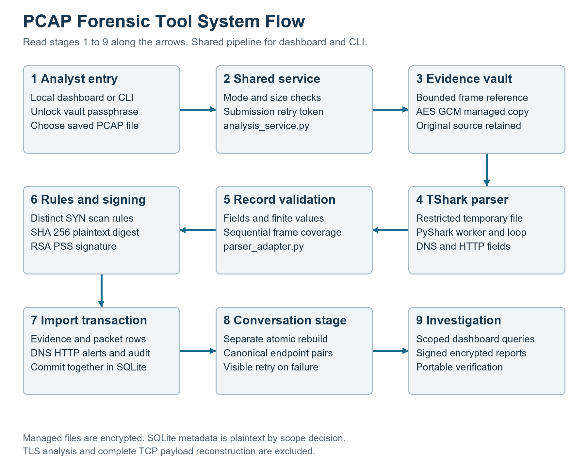
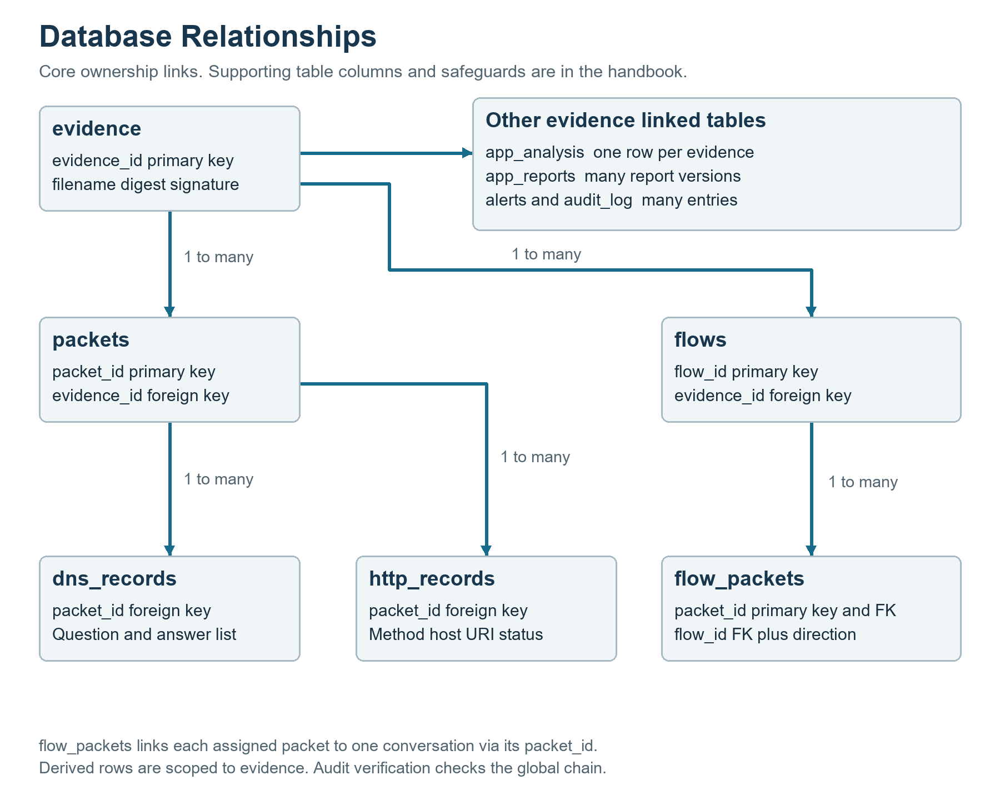

# PCAP Forensic Tool Viva Handbook

Prepared for Priyali, Aanya and Jahnnavi on 2 November 2026. This handbook explains the implementation merged into master at commit 90686e27d8cb9286f293475ddfb37758dd9e8884. It is a study guide to the actual code and tested behaviour. It cannot predict every possible viva question, but it covers the architecture, module interfaces, algorithms, cryptographic decisions, schema, failure paths and limitations you should be able to defend.

Read Sections 1 to 4 first. Learn Sections 5 to 12 for implementation detail. Practise the question bank aloud. Use the generated source index to locate exact functions and code lines rather than memorising filenames without understanding their relationships.

Start by explaining the system to a teammate without opening the code. Then open each function in the corresponding import or verification path and check whether your explanation matches its actual inputs, outputs and failure handling. Use the demo walkthrough to connect those code paths to visible results.

Priyali should lead cryptography, detection, the dashboard and integration explanations. Aanya should lead the storage, schema, transaction and query explanations. Jahnnavi should lead packet extraction and parser-contract explanations. Every member should still be able to describe the complete pipeline and its limits.

The accompanying system-flow and database diagrams can be shown directly during questions. The source index contains clickable links to function definitions at the code baseline. The demo walkthrough supplies a longer presentation and a five-minute alternative. Database encryption is deferred and TLS is excluded throughout this material.

## 1 The project in one minute

We built a local tool for analysing saved PCAP and PCAPNG network captures while preserving a verifiable evidence baseline. An analyst unlocks the dashboard and imports a capture. The application validates its container and size, encrypts a managed copy, extracts supported network and DNS/HTTP fields through PyShark and TShark, checks record validity and frame coverage, runs two scan heuristics, and signs the digest of the original plaintext capture. SQLite links evidence to packets, protocol records, alerts, conversations, report versions and audit events. The dashboard queries a selected evidence item and produces signed encrypted HTML reports that can be independently verified.

The active scope excludes TLS analysis, live packet acquisition, automatic attack blocking, complete TCP payload reassembly and encrypted SQLite storage. The last item was deliberately deferred. The application does not prove that an uploaded capture was truthful before import or that no undetected attack occurred.

## 2 The concepts that must stay separate

| Concept | Meaning in this project |
| --- | --- |
| Original capture | The bytes selected for import. The user-supplied source file is not rewritten. |
| Managed evidence | A unique encrypted copy under the configured evidence storage directory. Its plaintext digest and signature establish the imported baseline. |
| Parsed metadata | Derived packet, DNS, HTTP and conversation information stored in SQLite. This database is currently plaintext. |
| Detection finding | A heuristic explanation of a qualifying TCP SYN pattern. It is not proof of malicious intent. |
| Digital signature | An RSA PSS signature used to verify content relative to a trusted public key. It is not encryption. |
| File vault encryption | AES GCM encryption of new managed artifacts, using a passphrase-derived key. It is not database encryption or network-transport protection. |
| Report | An evidence-scoped versioned summary whose saved content can be signed and verified. It reflects generation-time data. |
| Audit chain | Linked hashes of operation records. A separately preserved signed checkpoint supplies a trust anchor for observed history. |

Security properties are different: confidentiality concerns who can read; integrity concerns whether content changed; authenticity concerns which trusted key authorised a signature; availability concerns whether the service and data remain accessible. This prototype addresses parts of those properties, not every threat to the laptop or network.

## 3 System architecture



The UI is Streamlit in dashboard.py, launched by launch_dashboard.py on loopback. run_security.py supplies a CLI over the same process_capture function in analysis_service.py. Sharing one service prevents dashboard and CLI detection/storage behaviour from diverging.

The application is layered: entry points, orchestration, capture extraction and validation, detection, persistence and queries, cryptography, and presentation/export. The parser does not decide that a scan is malicious; detection operates on normalized records. The report generator does not invent alerts; it reads evidence-scoped rows already stored.

TShark is an external executable. PyShark is its Python wrapper, not a replacement executable. Python packages are installed in .venv-parser on the demonstration laptop. The launcher prefers that interpreter, avoiding the earlier problem where a different Python installation could not import PyShark. TShark can be discovered through an explicit path, TSHARK_PATH, PATH or supported common installation paths. See the PyShark upstream project and TShark manual in Section 16.

## 4 One import from beginning to end

1. The dashboard gate checks local-only binding and an unlocked analyst session before the dashboard initializes or reads investigation data. In full mode the analyst explicitly acknowledges plaintext SQLite metadata storage.
2. process_capture accepts a path or uploaded bytes. It validates the requested mode, enforces the 20 MiB capture limit, resolves the vault passphrase, reads bytes, and initializes the schema additively.
3. It checks submission_id. An existing token may be reused only for the same capture digest and mode. This is submission idempotency, not a global ban on duplicate files.
4. It creates a unique artifact directory, removes directory components from the original display filename, and uses a generated managed filename. The source path is not used as an arbitrary storage destination.
5. capture_records.read_network_records validates the bounded Ethernet capture and obtains independent frame coverage and network fields. This reader uses Scapy and struct-based container checks.
6. The managed capture is written as an AES GCM .vault artifact. Full mode decrypts the managed bytes for parsing and invokes integration_runtime.parse_content. Network-only mode uses the independent network records and does not persist packet/protocol/flow rows.
7. A dedicated worker thread creates its own asyncio loop. A temporary directory is restricted before plaintext is written for TShark. On Windows the ACL grants the current analyst and SYSTEM; the temporary input is removed on completion or error. This is cleanup, not guaranteed forensic secure erasure.
8. parser.parse_pcap checks the capture container and creates PyShark FileCapture with keep_packets=False. extract_packet yields normalized dictionaries. Repeated supported DNS answers and multiple HTTP layers are preserved. Invalid required fields or extraction failures abort instead of being skipped silently.
9. parser_adapter.preview_capture validates each dictionary, finite timestamps, ports, flags, addresses, protocol records and JSON values. It compares sequential frame numbers and total count against the independent reader. This catches missing, duplicate and reordered frames, not every possible semantic error in an extracted field.
10. run_network_detection applies the port-scan and host-scan rules. secure_evidence signs the SHA 256 digest of the original plaintext content; it does not sign only the ciphertext. Signature manifests and archived public keys support later verification.
11. A BEGIN IMMEDIATE transaction stores evidence, app_analysis, packet/DNS/HTTP rows in full mode, capture-level alerts and import/detection audit entries together. integration_storage reuses the database packet helper on this same connection. It does not also call the standalone bridge and insert duplicate evidence.
12. After that transaction commits, reconstruct_flows rebuilds the selected capture's conversations and memberships in its own transaction. Successful finalization stores flow_count and INTEGRATED_LIMITED. Failure retains valid signed evidence and packet rows under FLOW_FAILED for a visible retry.
13. The dashboard selects the returned evidence ID and queries only its investigation records. Reports are generated separately on request, not automatically at every import.

These are two database transaction stages plus filesystem work. Do not say that one transaction makes the entire filesystem and database atomic. Import cleanup removes its own uncommitted files on normal precommit failures, but process crashes or unusual commit failures can leave orphan artifacts requiring review.

### Analysis states

| State | What it means |
| --- | --- |
| NETWORK_ONLY | Evidence, network summary, alerts and audit exist; stored packets/DNS/HTTP/flows were not requested. |
| PROCESSING_FLOWS | The full import transaction succeeded and the conversation stage is not finalized. |
| FLOW_FAILED | Conversation reconstruction failed; evidence and packets are retained and can be retried. |
| INTEGRATED_LIMITED | The supported full pipeline completed; format and confidentiality limits still apply. |

## 5 Capture formats and parser design

PCAP stores a file header and packet records; PCAPNG uses typed blocks and interface information. Our active input boundary is at most 20 MiB and 100000 packets with Ethernet link layers. Tests cover classic PCAP byte orders, microsecond/nanosecond variants, PCAPNG, IPv4, IPv6 and VLAN examples. This does not imply support for every possible PCAPNG block combination, network link type or malformed dissector output.

Each normalized record includes timestamp, frame_number, src_ip, dst_ip, protocol, src_port, dst_port, length, tcp_flags, dns_records and http_records. Missing fields are rejected by the adapter. TCP and UDP require valid endpoint IPs and ports. Nontransport records can legitimately have absent ports. Frame numbers start at one and are capture identifiers; packet_id is a database identifier and can differ across imports.

Timestamps become UTC epoch seconds at the adapter and are stored by database helpers as UTC ISO strings with microseconds. Capture time describes the packet timestamp reported by the file. Import/audit time is the application's local clock converted to UTC. Neither supplies an independent trusted timestamp authority.

In full mode length means TShark's original frame length. The independent reader measures captured bytes. A truncated-on-purpose snaplen capture can therefore have fewer captured bytes than reported wire bytes. Neither count is the size of the entire PCAP file, and total_bytes is not unique application payload volume.

DNS extraction uses all occurrences of supported PDML fields, aligns resource owner/type information, and retains repeated A, AAAA, CNAME, MX, NS, PTR and TXT values. Multiple DNS questions can create multiple rows; the message's answers are attached once to its first question row. Other resource types are not extracted. Multi-string TXT resources are rejected explicitly in this release.

HTTP extraction walks every HTTP layer instead of taking only the first. It records method, host, URI and response status where present. Ambiguous repeated fields within a grouping are rejected to avoid assigning one message's host to another. These are dissector-provided fields, not a claim that the application reconstructs every complete HTTP transaction or decodes encrypted payloads.

Required numeric checks reject nonfinite time, nonpositive frame numbers, negative lengths, out-of-range ports and flags. Ports are 0 through 65535; TCP flags retain up to 12 bits, 0 through 4095. HTTP status is constrained to 100 through 599 when present. ParserExtractionError includes frame_number, parsed_count and failed_count. The CLI logs parsing errors and exits nonzero; generator cleanup closes capture resources even on early termination.

keep_packets=False limits PyShark's retained packets, but the integration still collects bounded records and an independent reference list. The whole application is not an unlimited constant-memory streaming system. At scale the parser subprocess, decoded object overhead and database operations can cost substantially more than the raw file size.

## 6 Detection algorithms

detection.py implements a shared _scan function. host_scan.py selects its host-counting variation; security_detection.py combines the two result lists. They consume normalized network records and do not inspect TLS, run machine learning or use a threat-intelligence service.

### Port scan

Only TCP records with SYN set and ACK clear are candidates. The condition is flags AND 2, and not flags AND 16. Group packets by source IP and destination IP. Within each group, sort by timestamp. A deque holds packets in the current 60 second window, and a frequency dictionary counts destination ports represented in that window. Remove packets older than current time minus the window and decrement their counts. If the number of distinct ports is greater than 20, record a qualifying window.

Twenty distinct ports do not trigger; twenty one do. Duplicate packets or retransmitted SYNs to one port do not by themselves increase the distinct-port count. The left boundary is inclusive because only strictly older packets are removed. The function reports the largest qualifying distinct-count window for each grouping, not one alert for every packet or every overlapping window.

### Host scan

Apply the same window logic but group by source IP and destination port. Count distinct destination IP addresses. This describes one source probing one service across hosts. Varying both port and host can distribute activity across groups and evade these simple thresholds.

### Complexity and tradeoffs

Grouping and window maintenance are approximately linear after timestamp sorting. Overall sorting is bounded by O(n log n) across groups, with O(n) retained records/groups in this implementation. The threshold and window are explainable and configurable at function level; the dashboard uses defaults of 20 and 60 seconds, rule version one.

Active findings are Medium Possible Port Scan and Possible Host Scan. Capture-level findings have evidence_id but can have NULL packet_id because they summarize many packets. They do not prove intent. Slow scans, distributed scans, UDP scans and other attacks are outside these rules. Legitimate monitoring or vulnerability scanners can be false positives. Zero findings do not mean zero risk.

### Severity index

risk_scoring.py adds Low 10, Medium 20, High 30 and Critical 40 points and caps the sum at 100. Categories are LOW below 25, MEDIUM from 25, HIGH from 50 and CRITICAL from 75. One Medium alert produces an aggregate score of 20 and category LOW. This is a simple presentation index, not an attack probability or statistically calibrated security score.

## 7 Database design and investigation queries



SQLite is an embedded relational database; it does not require a separate MySQL server. Python's sqlite3 module provides the connection. schema.sql defines authoritative storage tables and safeguards; analysis_service adds application bookkeeping tables. SQLite schema design is separate from the SQL language and from database encryption.

| Table | Primary role and relationships |
| --- | --- |
| evidence | evidence_id, managed filename, original plaintext sha256, import_time and signature path. |
| packets | packet_id, evidence_id, timestamp, endpoint fields, transport/network protocol, original frame length, frame_number and tcp_flags. |
| dns_records | dns_id and packet_id link to question/status/answers metadata. answers is JSON text, not a separate answer table. |
| http_records | http_id and packet_id link to method, host, URI and status_code. |
| alerts | alert_id, evidence_id, optional packet_id, type, severity, description and event time. |
| flows | flow_id and evidence_id plus canonical endpoints/protocol, first/last times, packet/byte and directional counts. |
| flow_packets | Each packet_id maps to a flow_id and a forward or reverse direction. |
| audit_log | Ordered operation entries with evidence ownership, previous/current hashes, details and hash version. |
| app_analysis | One row per evidence, unique submission_id, original filename, signing key ID, status, packet count and context JSON. |
| app_reports | Versioned report ownership, path, detached signature path, plaintext digest and generation time. |

Connections enable PRAGMA foreign_keys=ON. Indexes cover evidence/time, endpoint IPs, protocol, alert evidence, protocol packet links, flow evidence and flow memberships. Indexes accelerate relevant lookups but add write and disk overhead; they do not make every query instantaneous. Queries still run over bounded data and some dashboard summaries load complete result lists.

Ownership triggers reject missing or inconsistent alert evidence/packet links and infer a missing alert owner from its packet when possible. They prevent changing a packet's owner in a way that invalidates an associated alert. Audited or alert-referenced evidence cannot simply be deleted through the normal guarded schema. These guards do not protect against a privileged attacker rewriting or replacing the entire database file.

create_database performs an additive migration inside a transaction: create absent tables, add specific missing columns, infer only justified missing alert ownership, then install indexes/triggers. It does not drop and reconstruct the user's historical tables. Unknown legacy owners remain unassigned rather than invented; preexisting inconsistencies require review. Historical TLS-related tables may remain, but the active workflow does not create or query TLS analysis records.

Values supplied to query filters are SQL parameters. Table/type selections are restricted to trusted names or allowlists. This differs from concatenating arbitrary user SQL. The generic fetch_all helper is an internal convenience, not a secure arbitrary-query interface for untrusted users.

### Conversations

reconstruct_flows groups by evidence ID, protocol and an unordered pair of endpoint tuples. An endpoint contains IP and port; absent ports use an internal sentinel. Sorting the endpoints creates a canonical ordering so request and response can join the same conversation. Forward means originating from that canonical lower endpoint, not necessarily the initiator.

The rebuild deletes the selected evidence's prior flow rows and recreates memberships inside one transaction. Other captures remain separate. Packet IDs stay stable, but flow IDs can change. There is no idle timeout or SYN/FIN session splitting: reuse of the same five-tuple within one capture can be aggregated. Packets without both IP addresses are skipped by the grouping stage. This is metadata aggregation, not full TCP session reconstruction.

### UI query behaviour

investigation.overview computes scoped counts, protocol breakdown, top source talkers, timeline and flow summaries. Packet filters accept an endpoint IP, protocol, optional UTC start/end and pagination. Packet pages show 100 rows. Conversation drilldown first checks evidence ownership and displays up to 500 packets. DNS/HTTP views display up to 500 rows; the timeline displays the latest 1000 buckets. These display limits are not claims that only those rows were stored.

### Readable example queries

These are study examples. The application uses bound parameters in its Python calls. Replace the example evidence ID with a real one.

```sql
SELECT protocol, COUNT(*) AS packet_count
FROM packets WHERE evidence_id = 1
GROUP BY protocol;

SELECT r.query_name, r.answers
FROM dns_records AS r JOIN packets AS p USING(packet_id)
WHERE p.evidence_id = 1;

SELECT * FROM alerts WHERE evidence_id = 1;

SELECT * FROM packets
WHERE evidence_id = 1 AND (src_ip = '10.0.0.1' OR dst_ip = '10.0.0.1');
```

## 8 Cryptography and trust

### SHA 256

The digest is 256 bits, usually displayed as 64 hexadecimal characters. The same bytes produce the same digest. A tiny modification generally produces a different digest; a matching digest is not an encryption mechanism or a statement about whether traffic is benign. calculate_sha256 reads large ordinary files in chunks and decrypts managed vault content before hashing it.

A plain digest stored beside a file cannot protect against an adversary who replaces both file and digest. The signature adds a private-key requirement for producing a valid signature under the already trusted public key. Authenticity still depends on trusting that key rather than accepting a replacement key chosen by an attacker.

### RSA PSS signatures

New signing keys use RSA 2048 with public exponent 65537. PSS uses MGF1 with SHA 256 and PSS.MAX_LENGTH salt. The implementation passes the 32 byte content digest using Prehashed SHA256 so the API does not accidentally hash that digest as though it were the original message. Verification either uses the matching Prehashed operation or hashes the original report bytes once in the standalone verifier. Both verify the same message digest.

PSS is randomized: signatures of the same content can differ while both remain valid. An RSA 2048 signature occupies 256 bytes. Verification uses the public key, not the private key. The private key signs; it is not used here to encrypt a whole PCAP. Do not describe signing as encrypting the hash with a private key; use the precise phrase RSA PSS signature.

Each artifact has a unique detached .sig and a version one JSON sidecar naming RSA-PSS-SHA256, the plaintext sha256 and the public key fingerprint. The fingerprint is SHA 256 over the DER SubjectPublicKeyInfo public-key encoding. Archived keys are addressed by this fingerprint in keys/public. The manifest is validated and checked against the digest/key, but is not a separate digital signature over all its JSON fields.

Key initialization is serialized with an exclusive lock file. Existing pairs are checked for consistency; incomplete or mismatched pairs are refused rather than replaced. New private keys are stored in password-encrypted PKCS8 PEM. Historical existing keys are preserved and may still be unencrypted; this code does not silently migrate them. Losing or deleting the old private key prevents future signatures under it, while losing the archived public key can prevent local historical verification. Back up keys securely.

### AES 256 GCM vault

New managed captures, reports and default report-export bundles are encrypted using AESGCM with a 32 byte key. Scrypt derives that key from a passphrase of at least 12 characters with a random 16 byte salt, N 32768, r 8 and p 1. Each envelope has a fresh random 12 byte nonce. The versioned magic header, purpose byte, salt and nonce are authenticated as associated data. The GCM authentication tag is included with the ciphertext.

The salt makes derivations different for the same passphrase and frustrates precomputed password attacks. The nonce is not a password or secret; it must not be reused with the same GCM key. Fresh salt normally also creates a fresh derived key. Random generation reduces reuse risk; this is not a mathematical guarantee that randomness never collides. Scrypt increases password-guessing cost but does not rescue a weak passphrase.

Wrong passwords or changed authenticated content result in VaultIntegrityError. GCM's check is symmetric: anyone who knows the passphrase can create authenticated encrypted content. RSA provides the separate public-key verification relationship. Vault payloads have a separate 64 MiB supported limit, while uploaded captures have the stricter 20 MiB limit.

Encryption covers managed copies, not the user's original uploaded source, plaintext SQLite metadata, old historical files or explicit decrypted downloads. TShark temporarily needs plaintext input. The unlocked process also holds plaintext/password material in memory; cleanup does not promise secure memory wiping, protection from administrators or resistance to a fully compromised laptop.

### Dashboard authentication

dashboard_auth stores a salt and Scrypt-derived verifier rather than a plaintext password. Password comparison uses hmac.compare_digest. The dashboard is single analyst and local-only, not a multiuser identity system. It holds the passphrase in session memory for decrypting artifacts, offers a Lock vault button, and requires unlock on the next interaction after 15 minutes of inactivity. Five failed attempts cause a 30 second delay in that session; this is not global distributed brute-force protection.

The CLI accepts the passphrase for cryptographic operations; it does not implement the same browser account-login flow. Use the established passphrase consistently so you can read old artifacts and encrypted signing keys. Resetting a login verifier does not recover encrypted data. There is no implemented passphrase recovery or automatic re-encryption/key rotation system.

## 9 Reports and audit history

report_generator.get_data selects the requested evidence and its alerts. generate_report also queries stored investigation summaries, escapes dynamic fields with html.escape, and writes a unique encrypted HTML file. A restrictive Content Security Policy reduces active HTML capabilities, but escaping is the essential protection against treating capture-derived hostnames or URIs as executable markup. A report is a snapshot, not a live dashboard.

generate_signed_report signs the plaintext report content, stores its app_reports version and appends REPORT_SIGN. Generating a report does not overwrite earlier versions. The report includes the evidence verification result observed at generation; a report signature establishes the report's integrity under its key, not the factual accuracy of every inference in it. If data later changes, the old signed report remains a signed historical snapshot.

report_bundle contains report.html, report.sig, report.sig.json, public_key.pem, verify.py and instructions. It excludes the private key, SQLite database and original capture. The default bundle is itself encrypted. After explicit authorized decryption/extraction, verify.py needs only Python and cryptography; it checks the manifest fingerprint/digest and the RSA signature, returning VALID or INVALID with a meaningful exit code.

Audit version one hashes operation, status, timestamp and previous hash; it has limited field coverage. Version two hashes canonical sorted compact JSON covering id, evidence_id, operation, status, timestamp, prev_hash, details and hash_version. The first link starts with GENESIS. Appends take a write transaction so concurrent writers do not choose the same old head casually.

An unkeyed hash chain can be recomputed by someone who can rewrite the whole database. A valid prefix can also remain after tail deletion. create_checkpoint records the current entry count, last ID and head digest in separately signed JSON. verify_audit can check that trusted prefix while allowing legitimate later appends. It cannot detect deletion of entries that were never covered by the preserved checkpoint. Preserve checkpoints and trusted public-key fingerprints outside the database an attacker could replace.

Do not claim that the audit chain authenticates every packet/alert column: it covers recorded audit events, not all derived tables. Evidence signatures and report signatures cover their respective artifact content. Neither turns this prototype into a legally certified chain-of-custody system without operating procedures, reliable acquisition, identities, timestamps, access records and trusted storage.

## 10 Modules and ownership

| Module or group | What to explain in a viva |
| --- | --- |
| launch_dashboard.py | Interpreter selection, safe subprocess argument list, project-relative launch and loopback binding. |
| dashboard.py | Vault gate, upload, mode/acknowledgement, idempotent submissions, selected evidence, Investigation, Alerts, Evidence Security, Audit Log and Reports pages. |
| analysis_service.py | Shared orchestration, schema initialization, transactions, evidence lifecycle, tokens, flow retry and verification audit. |
| capture_records.py | Independent bounded container and frame reader; limited network-only mode and full-mode coverage reference. |
| parser.py | TShark discovery, container checks, field extraction, repeated DNS/HTTP handling, numeric checks, fatal extraction errors and cleanup. |
| parser_adapter.py | Contract validation, sequential frame coverage, finite JSON checks and read-only parser previews. |
| integration_runtime.py | Dedicated worker/event loop, restricted temporary TShark input and parser invocation. |
| integration_storage.py | Store packets and protocol rows on the application's existing transaction connection. |
| database.py and schema.sql | SQLite connection, migrations, inserts, ownership safeguards, flows, audit hashing and scoped queries. |
| parser_db_bridge.py | Standalone transactional parser-to-database bridge, preserved for its owner's interface/tests; not also invoked during the application import. |
| investigation.py | Evidence-scoped query facade and cross-evidence flow ownership check. |
| detection.py and host_scan.py | Shared sliding-window TCP SYN heuristics with distinct-port or distinct-host grouping. |
| security_detection.py | Combine current network detection; run_all_detection is a compatibility alias, not active TLS analysis. |
| crypto_utils.py | Persistent keys, digest, RSA PSS signatures, public-key archives/manifests and verification. |
| confidentiality.py | Passphrase context, Scrypt, AES GCM envelope, encrypted reads/writes and legacy artifact support. |
| dashboard_auth.py | Local session gate, salted verifier, lock and inactivity handling. |
| report_generator.py | Escaped evidence-scoped HTML, signed versioned artifacts and encrypted portable bundle. |
| risk_scoring.py | Bounded weighted severity index. |
| audit_security.py | Read-only global chain checks and signed external checkpoints. |
| run_security.py and verify_evidence.py | User-facing import/verification CLI options and exit behaviour. |
| verify_artifact.py and vault_cli.py | Explicit-public-key verification and explicit file encryption/decryption without overwriting outputs. |
| prepare_demo.py and demo scripts | Deterministic input generation, isolated demonstrations, deliberately damaged copies and machine-readable PASS results. |
| parser_readiness.py and parser_preview.py | Dependency discovery and read-only parser acceptance inspection; these do not by themselves import evidence into the application. |
| tests and team_tests | Current isolated regression suite and unchanged owner tests with public/synthetic fixtures. |
| Legacy root scripts | Earlier standalone demos/tests, parser_backup.py and old TLS/weak-crypto experiments; not the supported dashboard workflow. |

Aanya's upstream storage/bridge/schema and owner tests are imported snapshots. Jahnnavi's parser was bundled in Aanya's reviewed branch and received documented integration completion patches. TEAM_SOURCES.json retains upstream blob/digest identifiers alongside installed hashes. Do not say every current parser byte is unchanged upstream. The source index supplied with this handbook lists actual function locations.

The readiness/preview helpers originated before integration. Some informational strings in parser_readiness.py and parser_adapter.py still describe a network-only or pending handoff. Those strings are historical helper labels, not live application status. Actual processing follows process_capture mode and the selected app_analysis status. Use the full application tests and integration rehearsal to demonstrate completed integration.

## 11 Testing and reproducibility

Run the supported commands from the project root:

```powershell
.\.venv-parser\Scripts\python.exe -m pip check
.\.venv-parser\Scripts\python.exe -m pytest -q
.\.venv-parser\Scripts\python.exe -m unittest discover -s team_tests -v
.\.venv-parser\Scripts\python.exe integration_demo.py
```

pytest.ini collects the isolated tests under tests, not the historical root scripts. Tests use temporary databases, artifacts, accounts and signing keys, and a public test-only passphrase. Never use that public test value for real evidence. Real-parser tests require both PyShark and TShark; environments without them can skip those cases, so the dedicated CI job installs TShark and exercises the actual pipeline.

101 application tests and 24 owner tests passed on the final code, including the merged master checkout. Coverage includes normal and scan cases, threshold/window boundaries, repeated destinations, SYN ACK exclusion, capture variants, malformed input, record failures, repeated DNS/HTTP, scope isolation, failed flow recovery, key persistence/mismatch, report escaping/signatures, tampering, password failures and checkpoints. The separate integration rehearsal also ran a public-key-only exported verifier successfully and observed failure after report modification.

GitHub Actions defines Ubuntu and Windows application jobs plus a real-parser Ubuntu job with TShark, owner tests, the complete application suite and the integrated rehearsal. CI success confirms those jobs on their tested environments; it is not a penetration test or proof of absence of bugs. Keep a precise commit/run link when explaining results.

## 12 Configuration and operation

| Setting or path | Meaning |
| --- | --- |
| PCAP_DB | Dashboard database override; otherwise runtime/forensic.db. CLI has its own explicit --db option. |
| PCAP_STORAGE | Dashboard managed-evidence root; CLI uses --storage. |
| PCAP_KEYS | Dashboard signing key directory; CLI uses --keys. |
| PCAP_AUTH_CONFIG | Dashboard verifier file override; default .secrets/dashboard_auth.json. |
| PCAP_VAULT_PASSWORD | Noninteractive passphrase input for isolated automation or controlled CLI use; do not log or commit real values. |
| TSHARK_PATH | External TShark discovery override. |
| STREAMLIT_SERVER_PORT | Choose a different local port when needed. |
| keys/private_key.pem | Existing analyst signing private key; ignored by Git. New keys are encrypted; legacy keys are retained as they are. |
| keys/public | Fingerprint-addressed public-key archive; needed for local versioned signature verification. |
| runtime | Managed database, captures, reports and disposable demos; ignored by Git. |
| .secrets | Local account verifier; ignored by Git. |

The repository contains a historical public verification key but not its private key. On a genuinely fresh clone, explicitly choose a separate new directory such as runtime/keys with PCAP_KEYS for the dashboard or --keys for CLI imports. Do not delete an incomplete established pair in order to sign with a replacement. On Priyali's configured laptop, retain the established directory and passphrase.

SQLite handles one active writer at a time. BEGIN IMMEDIATE can wait or fail if another writer is active; this is not a distributed high-concurrency service. Loopback binding limits network reachability but does not protect against every local process. Depend on OS account security, backups and appropriate handling of decrypted exports in addition to application controls.

## 13 Likely viva questions and answers

### Purpose and architecture

**Q1 What problem does your project solve?** It joins investigation and evidence handling for saved captures: searchable metadata, explainable scan findings and integrity-verifiable evidence/reports. The contribution is the integrated workflow rather than inventing a packet dissector or cryptographic algorithm.

**Q2 Why not just use Wireshark?** Wireshark is a richer packet investigation tool, and we reuse its dissectors through TShark. Our project adds a scoped SQLite investigation model, repeatable rules, managed encrypted artifacts, persistent signatures, report versions and audit checkpoints in one teaching prototype.

**Q3 Is this an IDS or a forensic tool?** It is primarily a saved-capture forensic analysis prototype with two detection heuristics. It does not continuously monitor an interface, block traffic or offer a complete IDS rule set.

**Q4 Where does execution start?** For the dashboard, launch_dashboard.py starts Streamlit and dashboard.py gates access before reading data. The upload action calls analysis_service.process_capture. run_security.py calls the same service from the CLI.

**Q5 Why use both PyShark and Scapy?** PyShark/TShark supplies rich supported protocol fields; Scapy supplies an independent bounded frame/network reference and deterministic synthetic fixtures. Agreement on frame coverage catches certain silent extraction failures, but using two libraries does not prove all fields are correct.

**Q6 What happens when I press Analyze capture twice?** Within the same dashboard submission token for the same database, content digest and mode, the stored result is returned. The unique database token and a second transaction-time check handle retries. Separate sessions or CLI invocations can intentionally import the same content again.

**Q7 Why is the status still INTEGRATED_LIMITED?** It means the supported pipeline finished while limitations remain explicit: only selected formats/protocol fields are covered, database metadata is plaintext, and complete TCP payload/session reconstruction is absent. It does not mean that normal imports are still waiting on integration.

### Networking and parsing

**Q8 What is a packet capture?** A file containing recorded frames plus capture metadata such as timestamps and lengths. It is input evidence for our saved-file workflow; the tool does not claim to have acquired it directly from the network.

**Q9 What is the difference between a frame, packet and flow here?** frame_number locates a frame in the original capture; packet_id identifies its normalized stored row. A flow is a bidirectional endpoint/protocol aggregation derived from many such rows.

**Q10 What is a five-tuple?** Source IP, destination IP, source port, destination port and protocol. We canonicalize the endpoint pair and add evidence identity to keep opposite directions together and captures separate.

**Q11 Are forward and reverse the same as client and server?** No. They follow sorted canonical endpoints, which keeps grouping consistent without making an unsupported claim about connection initiation.

**Q12 Why can one HTTP exchange still show TCP in the protocol chart?** The packet table labels the transport/network protocol, while HTTP fields live in a separate linked application table. Different network layers describe different things.

**Q13 Do you decrypt HTTPS or analyse TLS?** No. TLS analysis is excluded. Seeing a port associated with an encrypted service does not mean its payload was decrypted or its cryptography assessed.

**Q14 Why can DNS row count differ from answer count?** A DNS row stores message/question metadata and an array of answers. One row can contain several supported answer resources; multiple questions may create more rows.

**Q15 How did you fix repeated DNS answers?** We read every relevant PDML field occurrence, preserve the resource owner/type/value relationships and avoid treating the first PyShark display value as the whole answer set. Real CNAME plus repeated-address tests verify the change.

**Q16 How do you handle multiple HTTP messages?** We walk all HTTP layers in the dissected packet. If fields within a grouping are ambiguous, the parser raises an error rather than guessing associations.

**Q17 What if one packet cannot be extracted?** The canonical parser raises ParserExtractionError with frame/progress information. The application import aborts before creating a successful evidence record. The independent adapter also detects missing or reordered frames.

**Q18 Does validation check every packet checksum and semantic detail?** No. It checks supported container structure and the implemented record constraints. That does not certify every dissector interpretation, network checksum or application transaction.

**Q19 Is your parser fully streaming?** PyShark avoids retaining all packet objects internally, but the app collects bounded normalized records and an independent reference list. The 20 MiB and 100000 frame limits bound the supported workflow.

**Q20 Why are captured bytes and wire bytes separate?** A capture may save only part of an original frame. Captured bytes represent saved frame content; full-mode wire bytes use the reported original frame lengths. Neither equals unique transferred application data.

### Detection

**Q21 Explain port scan detection without code.** For each source/target pair, count distinct destination ports in a moving 60 second window among TCP SYN packets without ACK. More than 20 produces one summary for the largest qualifying window.

**Q22 What changes for a host scan?** Group by source and destination port, then count distinct destination IPs. This detects one service probed on many hosts.

**Q23 Why not count total SYN packets?** Retransmissions and repeated attempts to the same destination should not automatically look like many different ports or hosts. Distinct-value counts reduce that particular source of false positives.

**Q24 Why exclude SYN ACK?** SYN ACK is normally a reply in a TCP handshake, not the initial probe direction we are counting. We require SYN set and ACK clear.

**Q25 Why choose threshold 20 and window 60 seconds?** They are explicit prototype settings that make the rule explainable and the fixtures reproducible. They need environment-specific evaluation and tuning; we have not established a universally optimal threshold.

**Q26 Will it catch slow scans or distributed scans?** Not reliably. Activity below the configured threshold or distributed across sources/groups can evade it. We document that limit instead of claiming universal detection.

**Q27 What are false positives and false negatives here?** A legitimate vulnerability scanner can generate a scan finding, a false positive for malicious intent. A slow malicious scan can avoid the threshold, a false negative for attack detection.

**Q28 Is the risk score machine learning?** No. It is a deterministic weighted severity sum capped at 100, with simple display categories. It is not a probability.

**Q29 Why does a Medium alert sometimes show LOW overall risk?** A Medium alert adds 20, while the aggregate MEDIUM category starts at 25. These are different scales in the current code, not evidence that the alert disappeared.

### Database and integration

**Q30 Why SQLite?** It is embedded, portable and sufficient for bounded local investigations. It avoids requiring a server installation and supports relational queries, indexes, constraints and transactions.

**Q31 How do you avoid mixing different captures?** Evidence IDs link packets, alerts, flows and application bookkeeping. Protocol rows join through packet IDs. UI/query wrappers scope by evidence, and a flow ownership check guards drilldown.

**Q32 Why can packet_id be NULL in alerts?** A scan summarizes many packets. It belongs directly to evidence rather than arbitrarily pointing at one packet as the sole cause.

**Q33 Why use transactions?** Related database writes should commit together or roll back together. The import transaction binds evidence, packet/protocol rows, alerts and initial audit events; flow reconstruction is a separate retryable stage.

**Q34 Why not call parser_db_bridge during the normal import?** That standalone bridge owns its own evidence insertion/transaction. Calling it as well would duplicate ownership and break the shared transaction. integration_storage reuses the connection-level helper instead.

**Q35 What does BEGIN IMMEDIATE do?** It starts a write transaction up front, helping serialize writers before dependent reads and writes. It can be busy if another writer already holds the necessary lock; it does not create unlimited concurrency.

**Q36 What do foreign keys and triggers accomplish?** They maintain relationships and reject unsupported owner changes or deletion of referenced/audited evidence through normal database operations. They do not stop someone with full file-level control from replacing the database.

**Q37 Why indexes?** They speed common scoped/time/protocol/link lookups at the cost of extra storage and insert maintenance. They are selected for actual query patterns, not as a blanket optimization for every operation.

**Q38 Is your SQL protected from injection?** User filter values are passed as bound parameters. Dynamic table/type choices come from trusted constants or allowlists. We do not expose the internal generic query helper as an untrusted query console.

**Q39 What happens if flow reconstruction fails?** Signed evidence and packet data remain. The service records FLOW_FAILED and an audit failure, and the Investigation page offers Retry flow reconstruction without reimporting packets.

**Q40 Are rebuilt flow IDs permanent?** No. Packet IDs remain, but a rebuild replaces derived flow rows and their memberships. The UI should use the newly queried flow IDs.

### Cryptography

**Q41 What is the difference between hashing, signing and encryption?** Hashing creates a fixed-length digest. Signing allows verification against a trusted public key. Encryption restricts reading to those with the decryption secret. Our system uses all three for different purposes.

**Q42 Why SHA 256 rather than just a filename or file size?** Names and sizes can remain unchanged after modification. The digest is content-derived and provides a strong integrity comparison, although an untrusted digest alone can be replaced.

**Q43 What exactly is signed?** The SHA 256 digest of the original plaintext capture or report, using RSA PSS with Prehashed SHA256. Encrypting the managed file does not change the baseline content being signed.

**Q44 Why Prehashed?** The code already computed the content digest. Prehashed tells the signing API to treat it as that digest rather than hashing the digest again as a new message.

**Q45 Why not encrypt the whole capture using RSA?** RSA is not used for bulk data here. AES GCM handles file content efficiently; RSA PSS supplies detached signatures. We do not implement RSA key wrapping or an RSA/AES envelope protocol in this release.

**Q46 Can a signature prove who captured the traffic?** Only with additional trusted key ownership and acquisition procedures. Our signature proves verification under a particular trusted key and baseline, not that a named human collected truthful network traffic.

**Q47 What if someone replaces the public key too?** A different self-consistent key/signature set can be created. Establish the expected fingerprint outside the replaceable files and preserve trusted artifacts. The bundle alone does not solve key distribution.

**Q48 Why archive public keys?** Older signatures must remain verifiable after future key changes. A manifest's fingerprint selects the matching public-key archive entry rather than assuming the latest key signed every artifact.

**Q49 What does the GCM tag detect?** Wrong keys/passwords or modification of authenticated ciphertext/header cause authentication failure. It does not prevent deletion of the file or prove a particular human created it.

**Q50 Why do you need salt and nonce?** The salt changes passphrase derivation; the nonce provides per-encryption uniqueness for GCM. They are stored with ciphertext and need not be secret, but nonce reuse under one key is unsafe.

**Q51 Why Scrypt?** It intentionally makes password guessing more expensive in computation and memory than a single fast hash. The exact parameters are in derive_key. Strong passphrases still matter.

**Q52 Is the password stored?** The account file stores a salted derived verifier, not plaintext. During an unlocked session, the passphrase is in application memory so files can be decrypted. The system does not promise secure memory erasure.

**Q53 Are all private keys encrypted?** Newly generated ones are password-encrypted PKCS8. Existing legacy keys are preserved and can remain plaintext; the prototype does not silently migrate them.

**Q54 What if the password is forgotten?** There is no recovery mechanism. A login reset cannot recreate a lost decryption secret. Protect the passphrase and make secure backups rather than claiming the application can recover encrypted evidence.

**Q55 Is the database encrypted?** No. That feature was deliberately deferred. The app encrypts managed capture/report files, but database IPs, DNS/HTTP metadata and other rows remain readable to someone who can access the file.

**Q56 How do you handle passive attacks?** We reduce unauthorized reading of supported saved artifacts through encryption and local access controls. We do not detect a silent observer from a saved capture or retroactively protect plaintext already transmitted over the network.

### Evidence reports and audit

**Q57 Why not re-sign during verification?** That would bless the current possibly modified content as a new baseline. Verification must check against the already established signature and expected key.

**Q58 What does VALID mean for an uploaded candidate?** Its bytes match the original baseline and signature checks under the configured trusted key. It does not mean the traffic is harmless or that its pre-import origin is proven.

**Q59 Can a valid signed report contain an incorrect finding?** Yes. Signing protects the report's content from unnoticed changes relative to its key; it does not guarantee detection correctness or factual truth. This is why reports label rules and limits.

**Q60 Why escape report text?** Captures can contain attacker-controlled hostnames, URIs or other strings. Escaping keeps those strings from becoming HTML markup or script in a generated report.

**Q61 Does the exported verifier need a private key?** No. After authorized bundle decryption, it needs the report, detached signature, manifest, public key, Python and cryptography. The private key is excluded.

**Q62 How is an audit entry linked?** Its hash includes the previous entry's digest. Version two additionally binds the specified identity, operation, status, timestamp, details and version fields in canonical JSON.

**Q63 Can an attacker rewrite an entire hash chain?** If they can rewrite the unkeyed database history, yes. A separately trusted signed checkpoint is needed to anchor an observed prefix. Unkeyed links alone are not an immutable ledger.

**Q64 How does the checkpoint allow later legitimate activity?** It verifies the prefix through the saved last ID/count/head. New entries can extend that valid prefix. It detects damage to checkpointed history, not every loss of later uncheckpointed entries.

**Q65 Does the audit chain sign every database row?** No. It checks operation records. Original evidence/report signatures authenticate their artifact content; derived packet/alert tables are not all independently signed.

### Tests limitations and improvements

**Q66 What tests are most convincing?** Positive cases are useful, but threshold boundary, malformed input rollback, missing-frame rejection, tampered evidence/report, wrong password, mismatched keys and failed-flow recovery tests show that failure paths are handled deliberately.

**Q67 Why have both owner tests and integration tests?** Module tests verify individual storage/parser contracts. Integration tests check that cryptography, parser, storage, detection, UI and reports agree end to end; either layer can fail independently.

**Q68 Are 125 passing tests proof of security?** No. They show those cases passed on specified environments. They are not exhaustive, formal verification, a penetration test or a guarantee against all malformed captures and operating-system attacks.

**Q69 What is the most important limitation to disclose?** Parsed SQLite metadata is unencrypted, and the supported parsing and detection subset is limited. Also disclose no live protection, no TLS analysis and no complete TCP payload/session reconstruction.

**Q70 What would you improve next?** Based on requirements: encrypted database storage with a migration/key contract; stronger acquisition/key trust procedures; more protocol and malformed-capture tests; flow timeout/session handling; performance evaluation; and broader evaluated detection. These are future features, not already implemented claims.

## 14 Code tracing exercises

Before the viva, trace these paths in the editor and explain each transition aloud:

1. dashboard.py upload button to process_capture to parse_content to preview_capture to parse_pcap/extract_packet, then back through validation, detection and the import transaction.
2. store_packets to database._insert_packet and DNS/HTTP inserts, then reconstruct_flows and final status. Identify the boundary between the two transactions.
3. Evidence Security Verify Evidence to verify_evidence to verify_evidence_file/bytes. Explain the expected digest, signature manifest, public-key archive and audit append.
4. Reports Generate and Sign Report to generate_report to generate_signed_report to sign_report, app_reports and REPORT_SIGN. Follow the exported verifier separately.
5. Audit Log Verify Audit Chain to verify_audit, and Save Signed Audit Checkpoint to create_checkpoint. Explain what is and is not covered.
6. Upload invalid.pcap and mentally follow the exception cleanup. Then trace the controlled FLOW_FAILED path without damaging a real database.

## 15 Glossary and revision checklist

PCAP is a saved packet capture format. PCAPNG is its block-oriented next-generation family. Ethernet is the supported link layer. IPv4/IPv6 address network endpoints. TCP and UDP are transport protocols. A port identifies a transport endpoint. SYN and ACK are TCP flag bits. DNS resolves names and carries resource records. HTTP carries application requests/responses. VLAN tags identify virtual LAN membership.

A digest is a fixed-length hash result. A detached signature is stored separately from its signed content. PKCS8 is a private-key serialization format. PEM is a text encoding wrapper; PEM alone does not imply encryption. DER is a binary encoding used for the public-key fingerprint. AEAD means authenticated encryption with associated data. A nonce supports uniqueness; a salt changes password derivation. Idempotency makes a retry return the existing operation's result. A foreign key links related rows. A transaction groups writes with commit/rollback behaviour. A checkpoint is an externally preserved authenticated observation of audit history.

Know these numbers: RSA 2048, exponent 65537, SHA 256 with 64 hex characters, AES key 32 bytes, Scrypt N 32768 r 8 p 1, salt 16 bytes, nonce 12 bytes, passphrase minimum 12 characters, capture limit 20 MiB, frame limit 100000, artifact payload limit 64 MiB, scan threshold strictly more than 20, time window 60 seconds, dashboard packet page 100, conversation detail 500, protocol display 500, timeline display 1000, inactivity boundary 15 minutes on next interaction, and session delay after five failed attempts.

Before presenting, each team member should be able to explain one import without skipping the cryptographic/plaintext boundary, distinguish evidence from derived rows, explain the two scan groupings, identify their module interfaces, demonstrate tamper verification without re-signing, explain a transaction failure, and state the limits without calling unimplemented features complete.

## 16 Source basis and further reading

The implementation itself is the authority for project behaviour. Read the source index and the relevant functions at the code baseline above. GitHub: https://github.com/Seababy-I/PCAP-Network-Analysis/tree/master . TEAM_SOURCES.json records upstream storage/parser provenance and local completion patches.

For general API and format concepts, consult primary documentation rather than assuming that every upstream capability is enabled in our application:

- PyShark upstream describes its wrapper relationship to TShark: https://github.com/KimiNewt/pyshark
- TShark manual documents capture reading and dissection output: https://www.wireshark.org/docs/man-pages/tshark.html
- Wireshark PDML reference explains the structured dissection format: https://wiki.wireshark.org/PDML
- Cryptography RSA documentation explains PSS and Prehashed signing: https://cryptography.io/en/stable/hazmat/primitives/asymmetric/rsa/
- Scrypt specification describes the password derivation design: https://www.rfc-editor.org/rfc/rfc7914
- SQLite documents enabled foreign-key enforcement: https://www.sqlite.org/foreignkeys.html
- SQLite documents transaction and BEGIN IMMEDIATE behaviour: https://www.sqlite.org/lang_transaction.html

This handbook is preparation for explaining the implemented prototype. Avoid memorising unsupported slogans such as tamper proof, hack proof, complete attack detection or full confidentiality. State the measured result, the relevant mechanism and the boundary of the claim.
